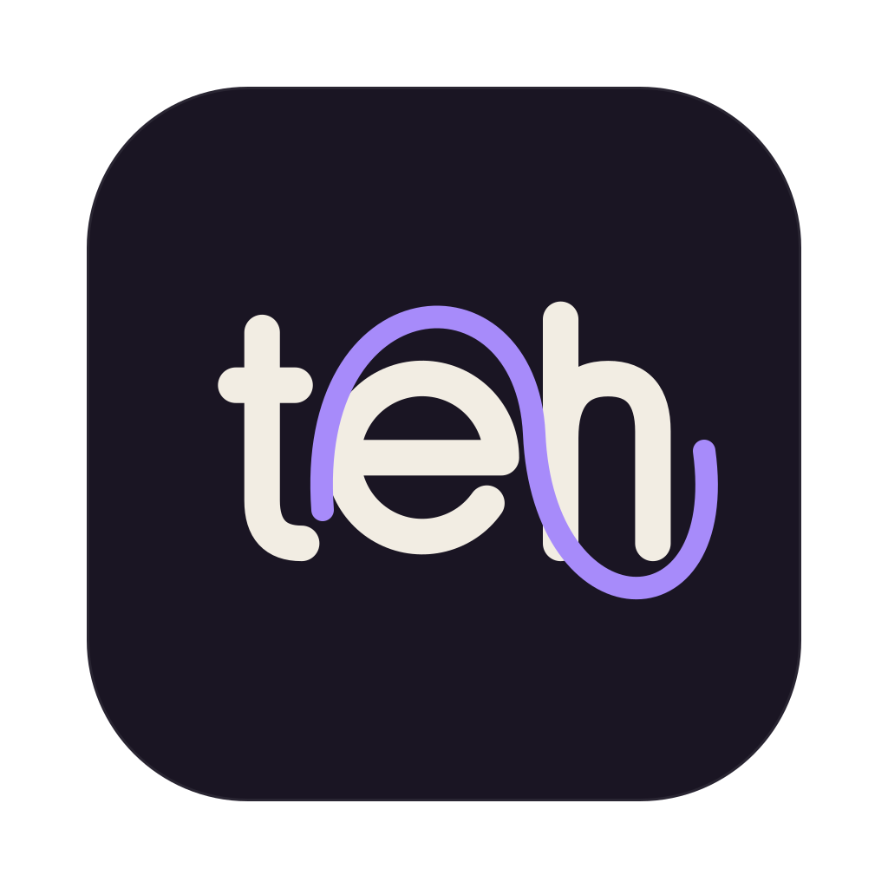

<p align="center">
  
</p>

<h1 align="center">Typo Learner</h1>

<p align="center">
  An autocorrect for macOS that learns from your own typos. English and Russian, fully on device.
</p>

I type fast and make the same few mistakes over and over. The macOS autocorrect doesn't know which ones are mine, and most third-party tools send keystrokes to a server. Typo Learner watches how you fix your own typos, builds a model of your slips, and only changes a word when it is very sure. It gets better the more you type.

There is no LLM and no network access. The app is sandboxed without the network entitlement, so it has no way to connect anywhere.

## How it learns

Every time you backspace and retype a word, the app records what you typed and what you meant: `wiht` became `with`, you hit `w` instead of `e`, you dropped a doubled letter. Those counts shape later guesses, so a slip you make often counts up to ten times more than a generic one.

It also learns which words you use and which words you use together, so `form` and `from` are judged by what usually comes before them in your writing. If you undo a fix, or mark it wrong in the dashboard, that pair becomes about 50 times less likely.

Not every edit is a typo. Changing one real word into another (`what` to `why`) is usually rewording, so it is only learned when it looks like a finger slip, such as a neighbouring key. Two words typed without the space between them (`inthe`) are split back apart.

For each finished word it scores every dictionary word within two edits:

```
P(meant | typed) ∝ P(typed | meant, your mistakes) × P(meant | previous word)
```

A fix only happens when that score clears 95%. A word the macOS spell checker already knows is never changed. One real word is swapped for another only when you have made that same swap yourself at least twice, and it still needs 99%.

The word lists are built from subtitles and include some junk. Rare entries that the macOS spell checker rejects and you have never typed are never suggested.

## Shadow first, then Active

The app starts in Shadow mode. It learns and logs what it would have fixed, but never touches your text. When you fix a typo yourself the same way it would have, that counts as a correct guess, even when you fix it before finishing the word. Fixing it a different way counts as a wrong one. The dashboard shows how many guesses have been judged and how many were right. Once it reaches 30 judged guesses at 95% or better, switch to Active.

In Active mode, undo a fix with ⌃⌥Z, or press Backspace right after it.

## Dashboard

Open it from the menu bar icon. It shows typos caught per day, accuracy over time, a keyboard heatmap of the keys you hit by mistake, the typo pairs it has learned, and CPU and memory use. You can mark guesses right or wrong, take a mark back along with everything it taught, protect words it should never touch, and block apps.

## Toward word prediction

Prediction is not turned on yet, but the groundwork is running. The app counts which words follow one word and which follow two, per app as well, and at every word it silently guesses what comes next. The dashboard shows how often the next word was in its top three, how often it was exactly right, and how many letters completion would have saved you. Those numbers say when prediction is good enough to switch on, without guessing.

## Privacy

The model stores statistics, never running text. The app holds only the current word and the two before it in memory, and drops them as soon as you move on. What it keeps is counts: how often you type a word, and how often one word follows another one or two.

What it learns is saved to one file encrypted with AES-256-GCM. The key lives in your login Keychain and never leaves this Mac. The file is at:

```
~/Library/Containers/io.github.zhqriks.TypoLearner/Data/Library/Application Support/TypoLearner/model.enc
```

Words outside the dictionary, such as names and slang, are kept as words inside that encrypted file, so the dashboard can show them and prediction can use them. Protected words are saved only as salted hashes. Password fields are never read, because macOS turns on secure input there and the app stops listening. Terminals, code editors and password managers are blocked by default, and you can block any other app from the dashboard.

## Build and run

You need macOS 15 or later and Xcode 16 or later.

```sh
git clone https://github.com/ZhQriks/type-learner.git
cd type-learner
./build.sh
open build/TypoLearner.app
```

`build.sh` signs with your Apple Development certificate if you have one, and falls back to ad hoc signing if you don't. Use a real certificate if you can: with ad hoc signing, macOS forgets the app's permissions every time you rebuild. To pick a certificate, set `SIGN_IDENTITY`.

On first launch, grant permissions from the menu bar icon. Input Monitoring lets the app see keystrokes and is required. Accessibility lets it type fixes and is only needed for Active mode. If the icon doesn't show up, your menu bar is probably full: macOS hides icons that don't fit next to the notch.

Run the engine tests with:

```sh
swift test
```

`Sources/TypoCore` holds the correction engine and has no UI code. `Sources/TypoLearner` holds the app: the event tap, key injection, hotkey, encrypted storage, and the SwiftUI views.

## Limits

It doesn't detect text typed in the wrong keyboard layout, such as `ghbdtn` for `привет`.

Fixes are typed as keystrokes, so a key you press in the same few milliseconds can land in the middle of a fix.

## License

The code is MIT licensed, see [LICENSE](LICENSE). The word lists in `Resources/` come from [FrequencyWords](https://github.com/hermitdave/FrequencyWords) by Hermit Dave and are licensed CC BY-SA 4.0.
